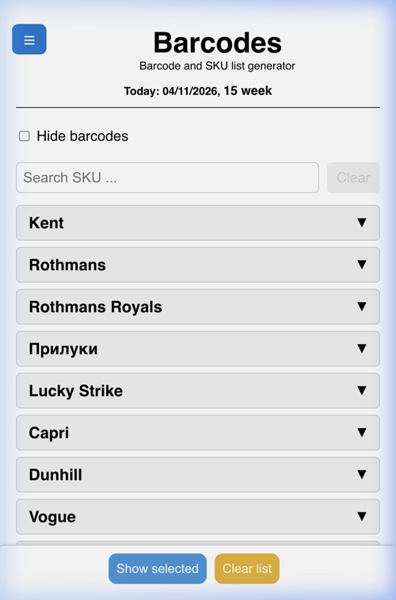
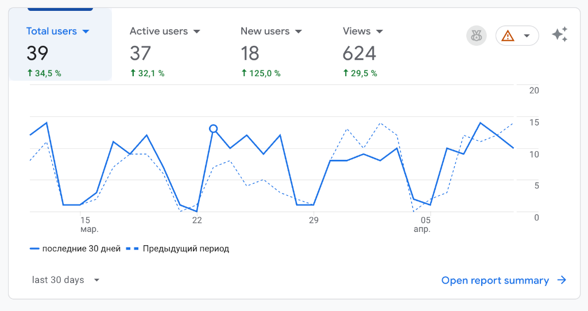
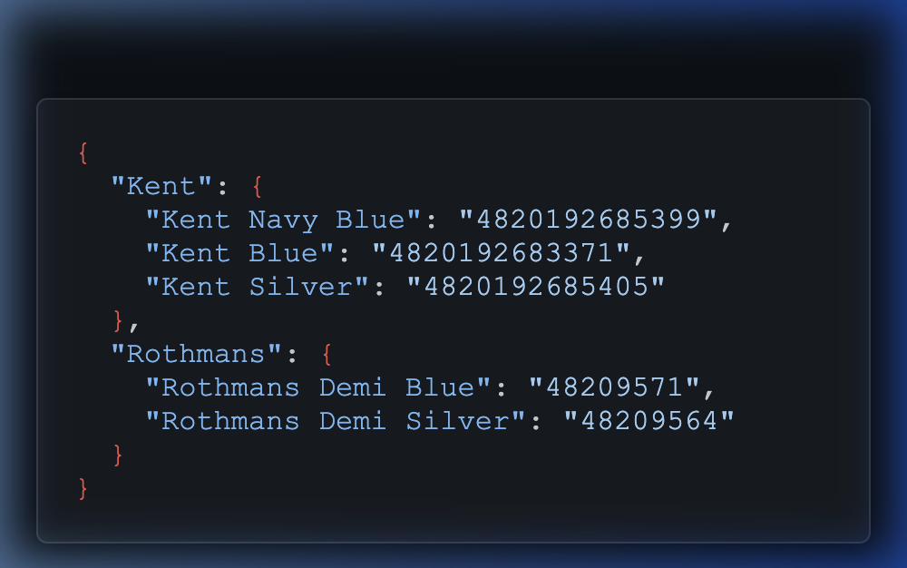

# 🚀 SKU Barcode & Retail Tools
## Від пілоту в Одесі — до національного інструменту команди

---

> [!IMPORTANT]
> **SKU Barcode & Retail Tools** — це сучасний веб-додаток, створений для оптимізації та прискорення роботи торговельних представників при перевірці стоку SKU.
> 
> Додаток дозволяє за лічені секунди знаходити потрібні SKU, об'єднувати їх у списки та миттєво генерувати точні штрих-коди прямо на екрані смартфона. Готові переліки можна легко надсилати відповідальним особам. Також він містить набір інтелектуальних калькуляторів для щоденної роботи торгового представника.

---

## 1. Передумови створення (Історія проблеми)

Початково додаток розроблявся як нішевий інструмент для окремих мерчендайзерів — для можливості перевірки наявності SKU у торгових точках за штрих-кодами. Але його подальший розвиток визначили реальні польові умови:

- 🔌 **Блекаути та відсутність інтернету:** Через відключення світла та перебої зі зв'язком штатний корпоративний додаток почав працювати зі збоями. Оскільки наш інструмент працює автономно (офлайн), торгові представники з власної ініціативи почали масово переходити на нього.
- 📋 **Боротьба з OOS (Out of Stock):** Торговим представникам був життєво необхідний швидкий інструмент, щоб при виявленні нестачі (OOS) миттєво формувати списки SKU та відправляти їх відповідальним особам.
- 🧮 **Адаптація новачків:** У нових торгових представників виникали значні складності з правильним розрахунком рекомендованого замовлення, що вимагало автоматизації цього складного процесу.

---

## 2. Рішення: SKU Barcode & Retail Tools

**[sku-barcode.vercel.app](https://sku-barcode.vercel.app/)** — це веб-додаток, яким можна користуватись як online, так і встановити на телефон або робочий планшет як PWA-додаток.

> [!NOTE]
> Додаток є Progressive Web App (PWA) і встановлюється на будь-який смартфон одним кліком — без App Store і без Google Play.

### Що вміє додаток:

| Інструмент | Що робить |
| :--- | :--- |
| **📦 Списки + Штрих-коди** | Миттєвий пошук SKU, формування списків, автогенерація штрих-кодів |
| **🛒 Рекомендоване замовлення** | Розрахунок на основі продажів, залишку та запасу |
| **📊 Річний об'єм продажів** | Розрахунок річних продажів у тисячах стіків. Нескладний розрахунок, але викликав помилки у нових співробітників |
| **⛽ Паливний звіт** | Автоматичний розрахунок витрат за одометром |
| **🔄 Конвертер стіків** | Переведення тисяч штук у пачки / блоки / короби |

> [!TIP]
> Алгоритм **Рекомендованого замовлення** базується на стандартах глобальних FMCG-лідерів — **Coca-Cola, Mars, Nestlé, PepsiCo**. Це не власна розробка "з нуля", а перевірена індустрією методологія, адаптована для нашої команди.

 

---

## 3. Пілотний проект: Одеса та Одеська область

> [!NOTE]
> Додаток був розроблений та протестований у реальних польових умовах з командою торгових представників Одеського регіону. **Ніхто не зобов'язував ним користуватися.** Усі результати нижче — це органічний вибір команди.

### Умови тестування:

- 📍 **Регіон:** місто Одеса та Одеська область
- 👥 **Команда:** 14 торгових представників + 3-5 мерчендайзерів
- ⏱️ **Тривалість:** 6 місяців
- 📱 **Впровадження:** добровільне, без наказу керівництва

---

## 4. Результати пілоту (Google Analytics)

### Ключові метрики:

| Метрика | Значення | Що це означає |
| :--- | :---: | :--- |
| Всього пристроїв | **39** | Кожен співробітник використовує додаток на ~2 девайсах (включаючи мерчендайзерів, які користуються дуже рідко) |
| Активних сесій | **37** | 95%+ всіх пристроїв залишаються активними (користувач взаємодіяв з додатком довше 10 секунд або здійснив цільову дію) |
| Нові пристрої | **+18** (+125%) | Додаток продовжує органічно поширюватись (всередині команди, переходячи з пристрою на пристрій) |
| Середньоденна активність | **10–11** | Майже вся команда заходить щодня |
| Охоплення в робочі дні | **~100%** | Інструмент став частиною робочого процесу |

### Головний висновок:

> [!IMPORTANT]
> При команді в **14 осіб** та **добровільному** використанні додаток отримав **~100% щоденне охоплення**. Це означає, що інструмент реально полегшує роботу — представники обрали його самі, без тиску зверху.
>
> Крім того, **39 унікальних пристроїв** підтверджують крос-платформність: один додаток однаково добре працює на смартфоні, планшеті та ПК в офісі.

---

## 5. 🌟 Ключові переваги

## 🌍 Мультимовність (i18n)

Додаток підтримує кілька мов інтерфейсу (наразі реалізовано: Українська та Англійська).

| Функція | Опис |
| :--- | :--- |
| **Автоматичне визначення** | Система самостійно виявляє мову системи та адаптує інтерфейс |
| **Легкість перемикання** | Миттєве перемикання мов без перезавантаження сторінки |
| **Збереження вибору** | Вибрана мова автоматично зберігається в `localStorage` (а це значить, що налаштування мови зберігатимуться для вашого подальшого використання) |

## ⚡ Продуктивність та Офлайн-доступ (PWA)

| Функція | Опис |
| :--- | :--- |
| **Швидкість** | Абсолютна відсутність затримок при роботі з додатком завдяки використанню сучасного React-стеку |
| **Автономність (PWA)** | Додаток працює без підключення до інтернету. Встановлюється одним кліком |
| **Оптимізація трафіку** | Всі операції, розрахунки та база SKU виконуються та кешуються локально |

## 💾 Локальне збереження даних

Не потрібно створювати акаунти чи залежати від сторонніх серверів:

> Вибрані SKU, проміжні дані розрахунків та налаштування мови зберігаються безпосередньо у браузері користувача (`localStorage`). При повторному відкритті додатку всі попередні дані та налаштування автоматично відновлюються.

## 📈 Гнучка архітектура та масштабування

*   **➕ Нові мови за хвилини:** Додавання нової мови — лише один JSON-файл з перекладом, без змін у коді.
*   **🔄 Гнучка база SKU:**

    

    База SKU підтягується з окремого файлу `sku.json` в папці проекту.

    **Переваги такого рішення:**
    - **Миттєвий доступ:** Дані завантажуються разом з інтерфейсом, нульова затримка
    - **Надійність:** Немає залежності від зовнішніх баз даних
    - **Просте оновлення:** Актуалізація назв та штрих-кодів — це лише заміна одного файлу

*   **🧩 Модульна структура:** Додавання нових калькуляторів не впливає на існуючий функціонал.

 

## ⚙️ Інтелектуальна синхронізація

В основі — кастомний модуль `useSkuData`, що реалізує двоетапну стратегію роботи з даними:

| Етап | Дія | Результат |
| :---: | :--- | :--- |
| **1** | Перший запуск → завантаження `sku.json` | Дані кешуються в `localStorage` |
| **2** | Повторні запуски → зчитування з `localStorage` | **Миттєвий старт без очікування сервера** |
| **3** | Фоновий `HEAD`-запит → перевірка `ETag` | Оновлення лише при реальних змінах файлу |
| **4** | Відсутність мережі → локальний кеш | **Повна підтримка офлайн-режиму** |

## 🚀 Хостинг та CI/CD (Vercel + GitHub)

Додаток розміщено на платформі **Vercel** у зв'язці з **GitHub**:

| Перевага | Деталі |
| :--- | :--- |
| **Безкоштовний хостинг** | Hobby plan — 0 грн/місяць |
| **Висока витривалість** | До 100 ГБ трафіку/місяць — з великим запасом для всієї команди |
| **Автоматичний деплой** | Будь-який push до GitHub → миттєва публікація на Vercel |
| **PWA-економія** | Код і база SKU кешовані на пристрої → перевищення лімітів технічно неможливе |
| **Глобальна CDN** | Миттєвий доступ незалежно від якості мобільного інтернету |
| **Безпека** | SSL + захист від DDoS включені за замовчуванням |

---

## 6. Чому це готово до масштабування

> [!NOTE]
> Додаток вже технічно готовий до запуску на всю Україну. Не потрібно нічого "переписувати" або "переробляти" — достатньо лише організаційного рішення.

**Що потрібно для національного запуску:**

| Дія | Зусилля | Хто відповідальний |
| :--- | :---: | :--- |
| Оновити базу SKU у `sku.json` | 🟢 Мінімальні | Технічна команда |
| Розіслати посилання [sku-barcode.vercel.app](https://sku-barcode.vercel.app/) | 🟢 Мінімальні | Менеджмент / HR |
| Провести короткий онбординг (5 хв) | 🟡 Середні | Менеджери |

---

## 7. Економіка проекту

| Категорія | Сума | Коментар |
| :--- | :---: | :--- |
| **Розробка** | Внутрішній ресурс | Розроблено силами команди |
| **Хостинг (зараз)** | $0 / міс | Vercel Hobby Plan |
| **Хостинг (після нац. запуску)** | $0 / міс | PWA-кешування = мінімальний трафік |
| **Підтримка** | Мінімальна | Періодичне оновлення файлу sku.json |

> [!TIP]
> **ROI проекту.** При нульових операційних витратах та підтвердженому щоденному використанні командою — кожна година часу, зекономлена торговим представником, є чистим прибутком. При 100 ТП національного масштабу та навіть 10 хвилинах економії на день — це **понад 250 годин продуктивного часу на місяць**.

---

## Додаток: Технічна документація

> *Детальна технічна документація доступна в окремому файлі `presentation_summary.md`*

- **Репозиторій:** GitHub (приватний)
- **Продакшн-URL:** [https://sku-barcode.vercel.app/](https://sku-barcode.vercel.app/)
- **Технічний контакт:** розробник проекту
