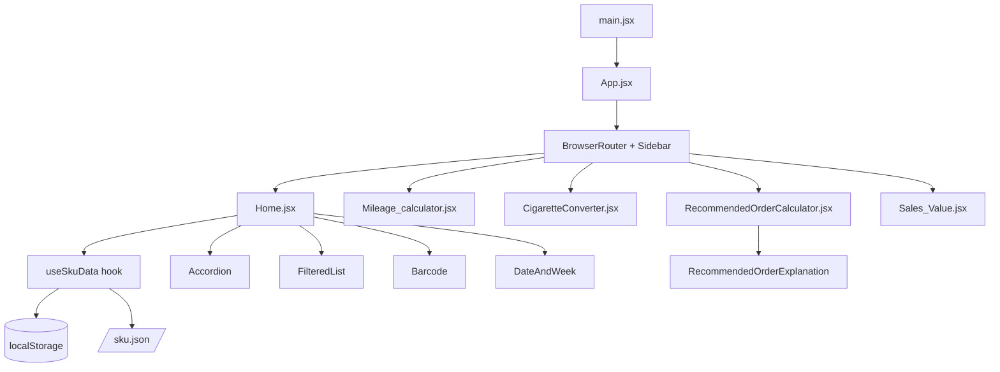

# 🔍 Технічна експертиза: SKU Barcode List

> **Дата:** 11 квітня 2026  
> **Проект:** `sku_barcode` (v3)  
> **Репозиторій:** `YriyProtcyshin/sku_barcode`  
> **Шлях:** `/Users/yuriy/Documents/React/sku_barcod_ver_3/sku_barcode`

---

## 1. Загальний огляд

Це **мобільний React-застосунок** (PWA) для управління асортиментом (SKU) і штрих-кодами в роздрібній торгівлі тютюновими виробами. Містить 5 функціональних модулів:

| Модуль | Файл | Призначення |
|---|---|---|
| **Штрих-коди** | `Home.jsx` | Перегляд, пошук, вибір SKU, генерація штрих-кодів |
| **Паливо** | `Mileage_calculator.jsx` | Калькулятор витрат пального |
| **Конвертер** | `CigaretteConverter.jsx` | Конвертер тис. стіків → пачки → блоки → коробки |
| **Рекомендований заказ** | `RecommendedOrderCalculator.jsx` | Авторозрахунок оптимального замовлення |
| **Об'єм продажу** | `Sales_Value.jsx` | Калькулятор річного обсягу продажів |

---

## 2. Технічний стек

```
React 19.1.1          ← актуальна версія ✅
Vite 7.1.7            ← актуальна версія ✅
react-router-dom 7.9.5
JsBarcode 3.12.1      ← генерація SVG штрих-кодів
react-toastify 11.0.5 ← сповіщення
react-icons 5.5.0     ← іконки
vite-plugin-pwa 1.0.3 ← PWA підтримка
Google Analytics (GA4) ← трекінг
```

> [!NOTE]
> Версії всіх пакетів актуальні та підтримуються (станом на дату аудиту).

---

## 3. Архітектура



### Структура директорій

```
src/
├── App.jsx              ← Routing + Sidebar
├── App.css              ← Глобальні стилі
├── main.jsx             ← Entry point + SW реєстрація
├── Components/
│   ├── Accordion/       ← Розкрийний список SKU
│   ├── Barcode/         ← SVG генератор штрих-коду
│   ├── DateAndWeek/     ← Дата + ISO-тиждень
│   ├── FilteredList/    ← Список при пошуку
│   └── RecommendedOrderExplanation/ ← Опис алгоритму
├── hooks/
│   └── useSkuData.js    ← Завантаження SKU + кешування
└── pages/
    ├── Home.jsx
    ├── Mileage_calculator.jsx
    ├── CigaretteConverter.jsx
    ├── RecommendedOrderCalculator.jsx
    └── Sales_Value.jsx
```

---

## 4. Аналіз ключових модулів

### 4.1 `useSkuData` — кастомний хук ✅ Добре реалізовано

Реалізує **двоетапне завантаження** з кешуванням:
1. Моментально повертає дані з `localStorage` для миттєвого рендеру
2. Робить `HEAD`-запит для перевірки ETag / Last-Modified
3. Завантажує нові дані тільки якщо файл змінився (`cache: "reload"`)
4. Обробляє offline-режим (повертає кеш, якщо мережа недоступна)

```js
// HEAD-запит → порівняння ETag → GET тільки при потребі
const headRes = await fetch("/sku.json", { method: "HEAD" });
const etag = headRes.headers.get("etag");
```

> [!TIP]
> Це ефективна патерн, що мінімізує мережеві запити. Хороша практика.

**Проблеми:**
- `JSON.parse` викликається двічі при ініціалізації (`useState` lazy init + `else` гілка)
- Немає захисту від invalid JSON в localStorage (може крашнутись)
- Тексти статусів (`"✅ Данные актуальны"`) змішані мовами (рос/укр)

---

### 4.2 `Home.jsx` — головна сторінка

- **Добре:** чіткий розподіл логіки (пошук, вибір, модал, копіювання)
- **Добре:** fallback через `execCommand('copy')` для старих браузерів

**Проблеми:**

```jsx
// ⚠️ console.log в продакшн коді
console.log("loadingStatus:", loadingStatus);

// ⚠️ Управління overflow напряму через DOM (не React-way)
document.body.style.overflow = "hidden"; // openModal
document.body.style.overflow = "auto";   // closeModal

// ⚠️ getFilteredData() викликається при кожному рендері
const filteredData = getFilteredData(); // має бути useMemo
```

---

### 4.3 `Mileage_calculator.jsx` — Паливний калькулятор

- **Добре:** зберігання стану в `localStorage` для збереження між сесіями
- **Добре:** `NumberInput` — реюзабельний дочірній компонент з кнопками +/-

**Проблеми:**
```jsx
// ⚠️ 5 окремих useEffect для localStorage — надмірно
useEffect(() => localStorage.setItem("startOdo", startOdo), [startOdo]);
useEffect(() => localStorage.setItem("startFuel", startFuel), [startFuel]);
// ... ще 3 такі самі

// ✅ Краще: один useEffect або useLocalStorage хук
```

---

### 4.4 `Sales_Value.jsx` — Калькулятор обсягу продажів

- Складна взаємопов'язана логіка конвертації (щодня ↔ тиждень ↔ місяць)
- Коректно обробляє порожні поля

**Проблеми:**
```jsx
// ⚠️ Змішані мови в UI — деякі тексти рос., деякі укр.
"Продажи в неделю (банок по 15 штук)"  // ← російська
"Продажи в год:"                         // ← російська

// ⚠️ unitAll зберігається в стані, але не виносить дефолт як константу
const [unitAll, setUnitAll] = useState(35); // "magic number"
```

---

### 4.5 `Accordion.jsx` — Компонент списку SKU

- **Добре:** лічильник обраних елементів `(вибрано/всього)`
- **Добре:** зелена підсвітка хедерів при вибраних позиціях

**Проблеми:**
```jsx
// ⚠️ Дублікат CSS-правила .accordion-header в Accordion.css (рядки 16 і 113)
.accordion-header { ... } // задвоєно

// ⚠️ .barcode-wrapper має margin-top вказаний двічі (рядки 57, 59)
.barcode-wrapper {
    margin-top: 5px;  // ← перезаписується
    margin-top: 10px; // ← виграє цей
}
```

---

### 4.6 `App.jsx` — Routing та Sidebar

- **Добре:** `body-lock` клас при відкритому меню (блокує скрол)
- **Добре:** overlay при відкритому сайдбарі (клік закриває)

**Проблеми:**
```jsx
// ⚠️ Закоментований import
import React, { useState, useEffect } from "react";
// import { useState } from "react"; // ← залишений закоментований рядок

// ⚠️ Коментар "//comment" без тексту в кінці файлу (рядок 102)

// ⚠️ Emoji ☰ та ✖ як кнопки — без aria-label
<button className="menu-button" onClick={() => setIsOpen(true)}>
  ☰  {/* ← немає aria-label="Відкрити меню" */}
</button>
```

---

## 5. PWA конфігурація

### vite.config.js — Workbox стратегії

| URL Pattern | Стратегія | Коментар |
|---|---|---|
| `/sku.json` | `NetworkFirst` | ✅ Правильно — актуальність важливіша |
| `*.js,css,png,svg` | `StaleWhileRevalidate` | ✅ Правильно для статики |

**Проблема:**
> [!WARNING]
> Маніфест має `short_name: "SKU BARCODE LIST"` (18 символів). Специфікація PWA рекомендує **до 12 символів** для short_name (відображається під іконкою на телефоні).

```js
// ⚠️ Слід скоротити:
short_name: "SKU LIST" // або "SKU Barcode"
```

**Також:** Файли `pwa-192x192.png` та `pwa-512x512.png` вказані в маніфесті, але їх немає у `public/` (потрібно перевірити або згенерувати).

---

## 6. index.html — SEO та мета-теги

```html
<!-- ⚠️ Дублювання мета-тегів -->
<meta name="apple-mobile-web-app-capable" content="yes" /> <!-- ← двічі -->
<meta name="apple-mobile-web-app-status-bar-style" content="black-translucent" />
<meta name="apple-mobile-web-app-status-bar-style" content="default" /> <!-- ← перезаписує! -->

<!-- ⚠️ Відсутня meta description -->
<!-- ⚠️ lang="en" але додаток україномовний -->
<html lang="en"> <!-- має бути lang="uk" -->

<!-- ⚠️ theme-color в HTML (#f59e0b) не збігається з vite.config (#ffffff) -->
```

---

## 7. Стилі (CSS)

### Змішана стратегія стилів — непослідовність

| Компонент | Підхід |
|---|---|
| `App.css` | Глобальний CSS |
| `Accordion.css` | Глобальний CSS (LocalCSS файл, але без `.module`) |
| `FilteredList.css` | Глобальний CSS |
| `Sales_Value.module.css` | CSS Modules ✅ |
| `mileage_calculator.module.css` | CSS Modules ✅ |
| `cigarette_converter.module.css` | CSS Modules ✅ |

> [!WARNING]
> Змішання CSS Modules і глобальних стилів — ризик конфліктів імен класів. Рекомендується **уніфікувати** підхід.

### Закоментовані блоки CSS

```css
/* ~12 рядків закоментованого коду в App.css */
/* .app-container { max-width: 800px; ... } */
/* padding-top: env(safe-area-inset-top); ... */
```

---

## 8. Зведена таблиця проблем

| # | Проблема | Файл | Критичність | Тип |
|---|---|---|---|---|
| 1 | `console.log` в продакшн | `Home.jsx:24` | 🟡 Середня | Код |
| 2 | DOM-маніпуляції (overflow) замість React-state | `Home.jsx:60,65` | 🟡 Середня | Код |
| 3 | `getFilteredData()` без `useMemo` | `Home.jsx:84` | 🟡 Середня | Перформанс |
| 4 | 5 окремих `useEffect` для localStorage | `Mileage_calculator.jsx` | 🟢 Низька | Код |
| 5 | Немає захисту від invalid JSON в localStorage | `useSkuData.js` | 🔴 Висока | Надійність |
| 6 | Дубльований CSS-рулс `.accordion-header` | `Accordion.css` | 🟢 Низька | Стилі |
| 7 | `margin-top` вказаний двічі (5px та 10px) | `Accordion.css:57,59` | 🟢 Низька | Стилі |
| 8 | Дублікати мета-тегів PWA | `index.html` | 🟡 Середня | SEO/PWA |
| 9 | `lang="en"` замість `lang="uk"` | `index.html` | 🟡 Середня | SEO |
| 10 | `short_name` PWA задовгий (18 символів) | `vite.config.js` | 🟡 Середня | PWA |
| 11 | Змішані мови (рос/укр) в UI | `Sales_Value.jsx` | 🟡 Середня | UX |
| 12 | Змішана стратегія стилів (модулі vs глобальні) | Всі компоненти | 🟡 Середня | Архітектура |
| 13 | Відсутність `aria-label` на іконкових кнопках | `App.jsx` | 🟡 Середня | A11y |
| 14 | Закоментований код (imports, CSS) | Кілька файлів | 🟢 Низька | Код |
| 15 | Немає `<meta name="description">` | `index.html` | 🟡 Середня | SEO |
| 16 | `theme-color` конфлікт HTML vs PWA маніфест | `index.html`/`vite.config.js` | 🟢 Низька | PWA |

---

## 9. Позитивні аспекти ✅

- ✅ **Оффлайн-підтримка** — продумана стратегія кешування SKU-даних з ETag
- ✅ **PWA** — застосунок встановлюється на мобільний пристрій
- ✅ **React 19 + Vite 7** — актуальний стек без застарілих залежностей
- ✅ **`StrictMode`** — увімкнений для виявлення проблем на етапі розробки
- ✅ **localStorage** — збереження стану між сесіями (Mileage calculator)
- ✅ **Модальне вікно** з анімацією для перегляду штрих-коду
- ✅ **Fallback** для `clipboard.writeText` через `execCommand`
- ✅ **Лічильник** обраних позицій у Accordion
- ✅ **Анімації** sidebar та modal з CSS transitions
- ✅ **Google Analytics** інтеграція
- ✅ **Safe-area insets** для iPhone notch/home indicator підтримки
- ✅ **`useMemo`-ready структура**: дані кешовані в localStorage до рендеру

---

## 10. Пріоритетні рекомендації

### 🔴 Критично (виправити найшвидше)

```js
// useSkuData.js — захист від пошкодженого localStorage
try {
  const saved = localStorage.getItem("sku_data");
  return saved ? JSON.parse(saved) : {};
} catch {
  localStorage.removeItem("sku_data"); // очистити пошкоджений запис
  return {};
}
```

### 🟡 Важливо

1. **Видалити `console.log`** з `Home.jsx:24`
2. **Виправити `lang="en"` → `lang="uk"`** в `index.html`
3. **Видалити дублі мета-тегів** в `index.html`
4. **Обгорнути `getFilteredData()` у `useMemo`**
5. **Уніфікувати мову UI** (або тільки українська, або двомовний інтерфейс)

```jsx
// Home.jsx
const filteredData = useMemo(() => {
  if (!searchTerm.trim()) return null;
  // ... логіка фільтрації
}, [searchTerm, skuList]);
```

6. **Замінити DOM-маніпуляції** для `overflow` на React-state + CSS клас
7. **Додати `aria-label`** до кнопок-іконок (☰, ✖)

### 🟢 Покращення якості коду

1. Замінити 5 `useEffect` в `Mileage_calculator` на один з `useMemo` або кастомний хук
2. Видалити закоментований код
3. Уніфікувати стилі (перейти повністю на CSS Modules)
4. Додати `<meta name="description">` у `index.html`
5. Скоротити `short_name` PWA-маніфесту

---

## 11. Загальна оцінка

| Критерій | Оцінка | Коментар |
|---|---|---|
| Функціональність | **9/10** | Все працює, логіка коректна |
| Архітектура | **7/10** | Розумна, але непослідовна у стилях |
| Якість коду | **7/10** | Є залишки debug-коду та дублювання |
| PWA | **8/10** | Хороша стратегія, дрібні помилки конфігурації |
| Перформанс | **7/10** | Відсутній `useMemo` у ключових місцях |
| A11y | **5/10** | Немає aria-label на інтерактивних елементах |
| SEO | **5/10** | Немає description, неправильний lang |
| **Загалом** | **7/10** | Зрілий проект з потенціалом для покращення |
